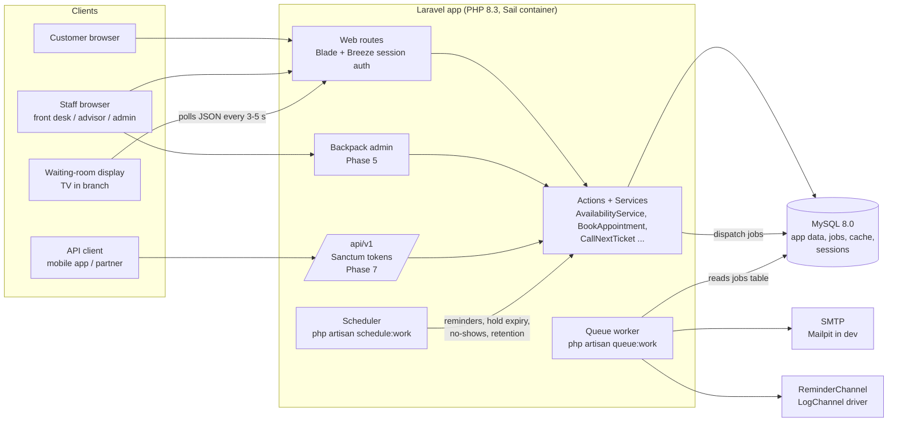
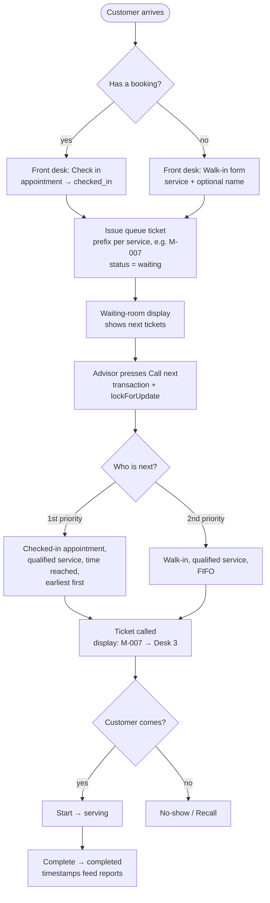

# BranchBook architecture

BranchBook is a single Laravel 13 monolith. One codebase serves four kinds of traffic: customer web
pages, staff web screens (front desk, advisor desk, Backpack admin), a versioned REST API, and
background work (queue worker + scheduler). Everything shares one MySQL 8.0 database.

Diagrams are Mermaid, so they render directly on GitHub and in VS Code's Markdown preview.
Items marked *(Phase N)* are planned for that phase and don't exist yet.

## 1. Components



Why one monolith: the domain is small and transactional (bookings, queue tickets), and every write
needs row locks in the same database. Splitting into services would add network calls inside what
must be a single transaction.

Why the database queue driver: no extra infrastructure (Redis is optional), jobs are visible with
plain SQL, and failed jobs land in `failed_jobs` for retry.

## 2. Customer booking flow *(Phase 3–4)*

```mermaid
sequenceDiagram
    autonumber
    actor Cu as Customer
    participant W as Booking pages
    participant AV as AvailabilityService
    participant BK as BookAppointment action
    participant DB as MySQL
    participant Q as Queue worker
    participant M as Mail

    Cu->>W: choose service, branch, date
    W->>AV: slots(branch, service, date)
    AV->>DB: hours, closures, shifts, time off, active bookings
    AV-->>W: free slots (cached 60 s)
    Cu->>W: pick slot + enter name, email, phone
    W->>BK: hold(slot, customer)
    BK->>DB: BEGIN; lock advisor row; check overlap; INSERT status=held (10 min)
    Note over BK,DB: unique index on active_slot_key<br/>is the final guard against double booking
    BK-->>W: hold created
    W->>Q: send OTP email (6 digits, hash stored)
    Q->>M: OTP
    Cu->>W: enter OTP
    W->>BK: verify(code)
    BK->>DB: compare hash (constant time), status held → confirmed
    W-->>Cu: reference NWB-XXXX-XXXX, checklist, .ics
    W->>Q: confirmation email + manage link (token hash stored)
    Note over Q: Scheduler: expire unverified holds every minute,<br/>reminder 24 h before, no-show 30 min after start
```

## 3. Branch-day flow *(Phase 6)*



Each ticket records `issued_at`, `called_at`, `served_at` and `completed_at`; Phase 8's wait-time and
utilisation reports are computed from these.
